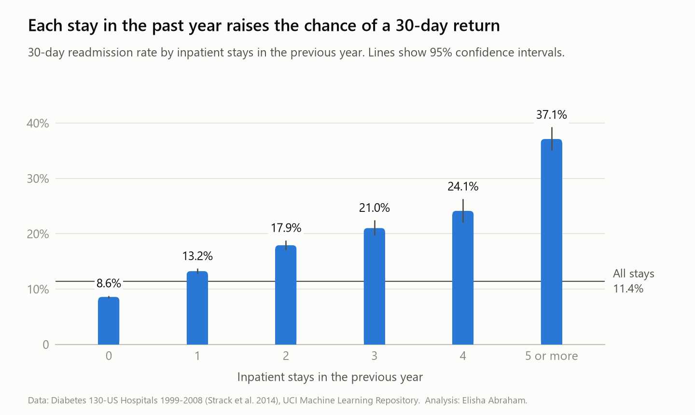
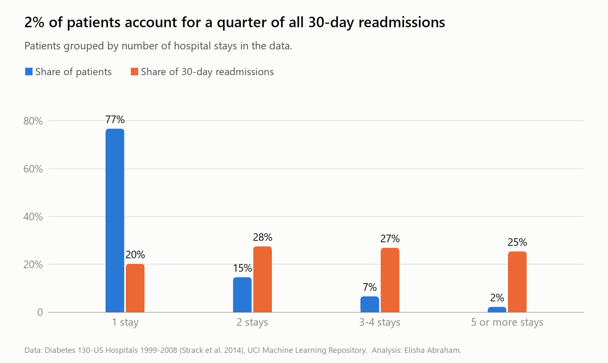
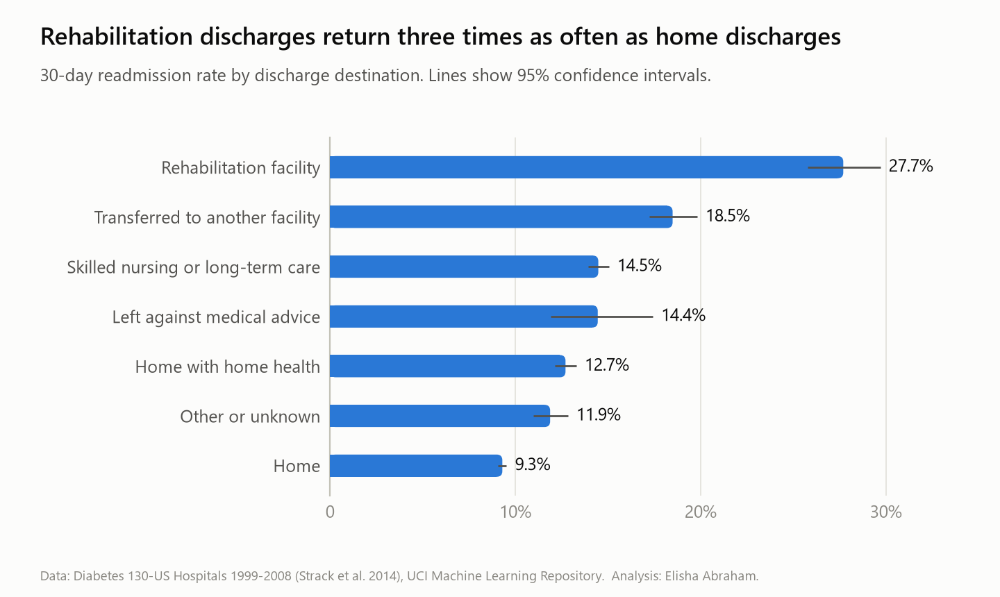
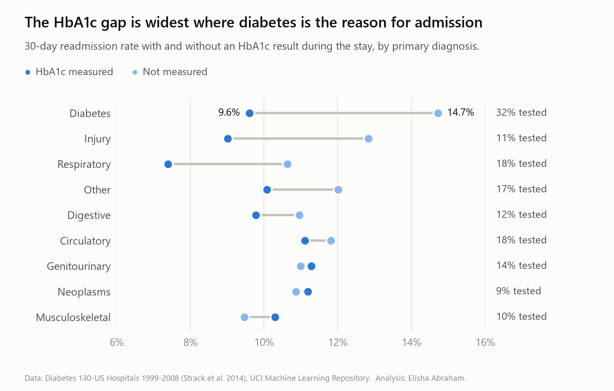
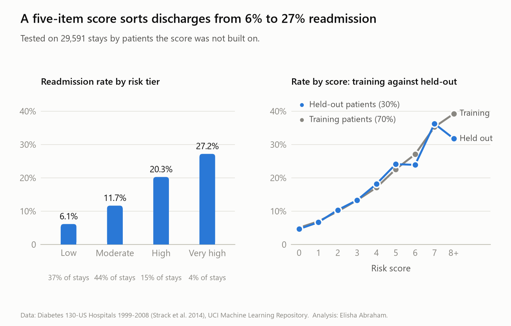

# Hospital readmissions among patients with diabetes

**Which patients come back to hospital within 30 days of discharge, and where should a hospital spend its follow-up effort first?**

An end-to-end SQL analysis of 101,766 inpatient stays at 130 US hospitals: raw file to audited data model, to findings, to a discharge-day risk score tested on patients it was not built on.

`MySQL 8` · `window functions` · `CTEs` · `data modelling` · `data quality` · `statistics in SQL` · `Python for checks and charts`

## The short answer

About 1 discharge in 9 was followed by a readmission within 30 days (11,314 of 99,343 stays, 11.4%). The problem is concentrated, and the facts that predict it are already in the record on the day of discharge.

1. **A small group of patients drives it.** 4.5% of patients (3,148 of 69,990) account for half of all 30-day readmissions.
2. **Past hospital use is the strongest signal.** The readmission rate rises from 8.6% for patients with no inpatient stay in the previous year to 37.1% for those with five or more.
3. **Where the patient goes next matters.** 27.7% of stays ending in discharge to a rehabilitation facility were followed by a readmission, against 9.3% of discharges home.
4. **Long-term glucose control was rarely checked.** HbA1c was measured on 16.9% of stays, and on only 31.6% of stays where diabetes was the main reason for admission. Tested stays were followed by fewer readmissions (9.9% against 11.7%).
5. **Sex and race made no practical difference.** Women 11.5%, men 11.3%; the two largest racial groups both 11.5%.

A five-item score built from these findings sorts held-out discharges into tiers that run from 6.1% to 27.2% readmission. Following up only the top two tiers means contacting 19% of discharges to reach 35% of all readmissions.

## What I would recommend

| # | Action | Evidence |
|---|---|---|
| 1 | Flag every discharge with two or more inpatient stays in the previous year for a follow-up call within a week. | 14.2% of stays, 27.5% of readmissions. |
| 2 | Add a handover step for discharges to rehabilitation and other facilities. | 5.5% of stays, readmitted at 18.5% to 27.7%. |
| 3 | Use the five-item score to set follow-up intensity by tier. | Top two tiers: one follow-up in 4.6 reaches a patient who returns, against one in 8.7 if every discharge is followed up. |
| 4 | Measure HbA1c during admission when no recent result exists, starting with admissions for diabetes. | 68.4% of diabetes admissions had no result. This is a care-quality step; the data cannot show that testing itself prevents readmission. |

## Findings in detail

### Readmission rises with every prior stay

<picture>
  <source media="(prefers-color-scheme: dark)" srcset="figures/readmission_by_prior_stays_dark.png">
  
</picture>

The same pattern appears for emergency visits (10.7% with none, 25.3% with three or more), and the two add up: at every level of inpatient history, patients who also had an emergency visit returned more often.

A stay that follows a 30-day readmission is itself followed by another one 21.6% of the time, 2.4 times the rate for a first stay (9.0%).

### A few patients account for most readmissions

<picture>
  <source media="(prefers-color-scheme: dark)" srcset="figures/patient_concentration_dark.png">
  
</picture>

### Discharge destination

<picture>
  <source media="(prefers-color-scheme: dark)" srcset="figures/readmission_by_discharge_destination_dark.png">
  
</picture>

### HbA1c testing

<picture>
  <source media="(prefers-color-scheme: dark)" srcset="figures/hba1c_testing_dark.png">
  
</picture>

Stays with an HbA1c result were followed by 15% fewer readmissions (relative risk 0.85, 95% CI 0.81 to 0.89; chi-square 42.3, p < 0.001). Tested patients are not the same patients as untested ones, so I compared like with like: within strata of primary diagnosis and inpatient history, the pooled Mantel-Haenszel relative risk is 0.92. Case mix explains a little under half of the gap. The rest is an association, not proof that the test prevents readmission.

## The risk score

Add up the points on the day of discharge.

| Item | Points |
|---|---|
| Inpatient stays in the previous year: one / two / three or four / five or more | 1 / 2 / 3 / 4 |
| Two or more emergency visits in the previous year | 1 |
| Discharged to a rehabilitation facility | 3 |
| Transferred to another hospital or facility | 2 |
| Any other discharge that is not straight home | 1 |
| Six or more diagnoses recorded | 1 |
| Stay of five days or longer | 1 |

**How the points were set.** Patients were split 70/30. Using the 70% only, each item earned one point for every 1.4-fold step in readmission risk. Because the items overlap (patients with many admissions also have more emergency visits and diagnoses), each item's relative risk was first adjusted for inpatient history with the Mantel-Haenszel method, so the same risk is not counted twice. The rules were then frozen and tested on the 30% they had never seen.

**Result on the held-out 30% (29,591 stays):**

| Tier | Score | Share of discharges | Readmitted within 30 days | Share of all readmissions |
|---|---|---|---|---|
| Low | 0 to 1 | 36.9% | 6.1% | 19.7% |
| Moderate | 2 to 3 | 44.2% | 11.7% | 44.9% |
| High | 4 to 5 | 15.3% | 20.3% | 27.0% |
| Very high | 6 to 10 | 3.6% | 27.2% | 8.4% |

<picture>
  <source media="(prefers-color-scheme: dark)" srcset="figures/risk_score_validation_dark.png">
  
</picture>

The AUC is 0.651 on held-out patients and 0.645 on training patients, so the score did not simply memorise the data it was built on. An AUC of 0.65 is modest: the score ranks patients usefully but cannot say who will return. It is a tool for deciding who gets a call first, not a diagnosis.

## How the work was done

| Step | Script | What it does |
|---|---|---|
| 1 | [`sql/01_create_schema.sql`](sql/01_create_schema.sql) | Staging table, three lookup tables, an ICD-9 range table, and the clean model with keys and check constraints. |
| 2 | [`sql/02_load_staging.sql`](sql/02_load_staging.sql) | Loads the raw CSV as text, so no value is coerced or lost on the way in. |
| 3 | [`sql/03_data_quality_audit.sql`](sql/03_data_quality_audit.sql) | Nine checks on the raw data. Each one records what it found. |
| 4 | [`sql/04_build_clean_model.sql`](sql/04_build_clean_model.sql) | Builds typed tables, resolves conflicting demographics, groups diagnoses, unpivots 23 medication columns, defines the analysis cohort. |
| 5 | [`sql/05_analysis.sql`](sql/05_analysis.sql) | Seven questions, from the headline rate to HbA1c testing, with confidence intervals, a chi-square test and a stratified relative risk written in SQL. |
| 6 | [`sql/06_risk_tiers.sql`](sql/06_risk_tiers.sql) | Derives the score on training patients, freezes it in a view, and tests it on held-out patients, including the AUC. |

### Data model

```
patients (71,518) ──< encounters (101,766) ──< encounter_medications (120,054)
                          │
                          ├── admission_types        (8)
                          ├── discharge_dispositions (30)
                          └── admission_sources      (25)

v_index_stays  = encounters that can be followed by a readmission (99,343)
v_risk_scores  = v_index_stays plus points, score and tier
rpt_*          = result views that feed the charts
```

### What the audit found, and what I did about it

| Finding | Decision |
|---|---|
| Missing values are written as `?`, `None` or `Unknown/Invalid`; there are no empty cells. | `?` becomes NULL. `None` in the lab columns means the test was not done, so it is kept as information. |
| Weight is missing for 96.9% of stays. | Dropped. |
| Payer (39.6%) and medical specialty (49.1%) are missing too often to trust. | Kept, not used for conclusions. |
| 123 patients have more than one recorded race and 3 more than one gender. | Most frequent value kept; patient flagged. |
| 2,423 stays ended in death or hospice. These patients cannot be readmitted in the ordinary sense. | Excluded from every rate. |
| The file has no dates. | Stays are ordered by `encounter_id`. I tested that assumption: it agrees with the readmission flags for 98.4% of stays that have a later stay. |
| Two medication columns are empty and five more have under five rows. | The long medication table simply has no rows for them. |

### How I know the numbers are right

- **Reconciliation.** Every raw row is accounted for after cleaning: 101,766 in, 101,766 out, split 99,343 analysed and 2,423 excluded.
- **Two independent implementations.** [`scripts/cross_check.py`](scripts/cross_check.py) recomputes 75 figures from the raw CSV in pandas, including the AUC, the chi-square statistic and every tier count. All 75 match the MySQL results exactly.
- **Held-out validation.** The score was built on 49,189 patients and tested on 20,801 others.

## Limits of this analysis

- **It describes, it does not prove cause.** These are associations in observational data.
- **The data are from US hospitals in 1999 to 2008.** Practice and drugs have changed, and other health systems differ. The method transfers; the numbers may not.
- **Readmissions outside the 130 hospitals are invisible**, so true rates are somewhat higher.
- **Stays by the same patient are not independent.** The confidence intervals treat them as if they were and are therefore slightly too narrow. Counting only each patient's first stay gives a rate of 9.0% instead of 11.4%.
- **No dates.** Seasonal patterns, time to readmission and trends over the ten years cannot be studied.

## Run it yourself

Requirements: MySQL 8.0 and Python 3.10 or later with `pandas` and `matplotlib`.

```bash
# once, as an admin user, to allow LOAD DATA LOCAL
mysql -u root -p -e "SET GLOBAL local_infile = 1;"

# from the project root
mysql --local-infile=1 -u root -p -e "source sql/01_create_schema.sql"
mysql --local-infile=1 -u root -p -e "source sql/02_load_staging.sql"
mysql -u root -p -e "source sql/03_data_quality_audit.sql"
mysql -u root -p -e "source sql/04_build_clean_model.sql"
mysql -u root -p -e "source sql/05_analysis.sql"
mysql -u root -p -e "source sql/06_risk_tiers.sql"

pip install -r requirements.txt
python scripts/export_results.py --user root --ask-password
python scripts/cross_check.py
python scripts/make_figures.py
```

The whole pipeline runs in about five minutes on a 4 GB laptop.

## Repository layout

```
data/raw/     the source files, unmodified
sql/          the six scripts, in run order
scripts/      export, cross-check and chart scripts
results/      CSV exports of the result views
figures/      charts, in light and dark variants
```

## Data and licence

Data: Clore, J., Cios, K., DeShazo, J., & Strack, B. (2014). *Diabetes 130-US Hospitals for Years 1999-2008* [Dataset]. UCI Machine Learning Repository. https://doi.org/10.24432/C5230J. Licensed CC BY 4.0. The records are de-identified.

The dataset was introduced in: Strack, B., DeShazo, J. P., Gennings, C., Olmo, J. L., Ventura, S., Cios, K. J., & Clore, J. N. (2014). Impact of HbA1c measurement on hospital readmission rates: analysis of 70,000 clinical database patient records. *BioMed Research International*, 2014, 781670. https://doi.org/10.1155/2014/781670

Code in this repository: MIT licence.

## Author

**Elisha Abraham** is a healthcare and research data analyst with clinical training in nursing.
[LinkedIn](https://www.linkedin.com/in/elisha-abraham-a90569352) · [GitHub](https://github.com/elisha-abraham)
